# Vibe Hero

<p align="center">
  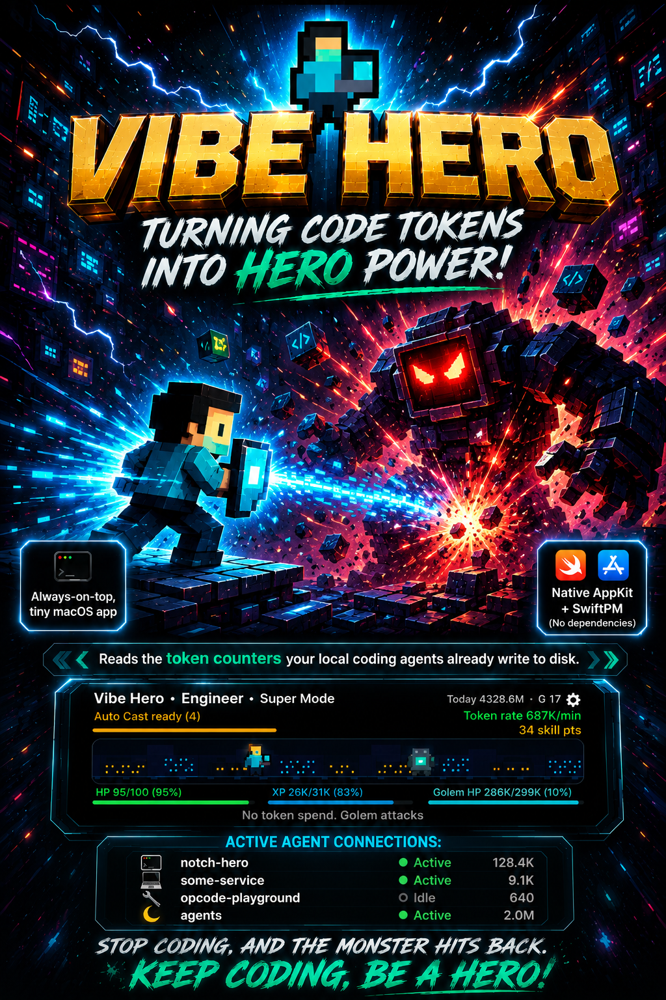
</p>

<p align="center">
  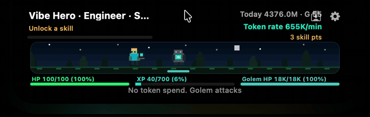
  <br>
  <em>Earlier animation demo. Current HUD and progression are shown below.</em>
</p>

Your MacBook notch is a pixel-art RPG, and your token usage is the sword.

Vibe Hero is a tiny native macOS app (AppKit + SwiftPM, no third-party dependencies) that
parks a transparent, always-on-top panel in the notch. It reads the token counters your
local coding agents already write to disk — Claude Code, Codex, OpenCode, Kimi Code — and
turns every token you spend into a hero attack. Stop coding and the monster starts hitting
back.

- macOS 14.0+ · Swift 6 (strict concurrency) · pure AppKit · zero dependencies
- Reads local usage counters, timestamps and session/project identities; session detection
  also checks running agent processes. Conversation text is not retained or uploaded.
- Accessory app: no Dock icon, lives in the notch and the menu bar

## Install

**Homebrew** — builds from source on your machine, so macOS never shows a Gatekeeper
prompt:

```sh
brew install tsonglew/tap/vibe-hero
cp -R "$(brew --prefix vibe-hero)/Vibe Hero.app" /Applications
open "/Applications/Vibe Hero.app"
```

Upgrades ride along with `brew upgrade`. First install takes a minute or two — it compiles
the package locally.

**Manual download** — grab `Vibe-Hero-v0.1.1.zip` from
[Releases](https://github.com/tsonglew/VibeHero/releases), unzip, and drag the app to
`/Applications`. The build is unsigned, and macOS quarantines anything downloaded in a
browser, so the first double-click is blocked. Remove the quarantine mark once:

```sh
xattr -dr com.apple.quarantine "/Applications/Vibe Hero.app"
```

(or System Settings → Privacy & Security → **Open Anyway** after the first attempt.)

Both paths are local-only: the app reads token counters from local agent logs and talks to
nothing on the network.

---

## 1. The game

### The loop

```
local JSONL logs ──► TokenUsageScanner ──► token delta ──► hero strike (1 base HP per token)
       │
       └── no new tokens for 15s ──► monster counterattacks every 2s until usage resumes
```

1. **Scan.** Every 2 seconds `TokenUsageScanner` refreshes today's token counters from local
   agent logs. The first pass reads the files; after that it tails only newly appended
   lines, so idle CPU stays near zero.
2. **Strike.** New tokens enter a combat ledger immediately. Each token deals one base HP,
   scaled by role, learned skills, combo, equipped gear, and any active Power Boost.
   Damage has no minimum percentage or per-hit cap. The same token budget and combat
   conditions produce the same damage regardless of how log updates are batched.
   Tokens also restore 1 hero HP per 1,000 tokens and add one unit of skill energy per
   token, with charge-node and equipment bonuses after learning an active skill.
   The energy pool holds 40,000 units; active skills cost 12,000–40,000.
3. **Idle risk.** With no token activity in the last 15 seconds, the monster counterattacks
   every 2 seconds for ~0.11 HP a hit (hero max HP is 100 — roughly half an hour of pure
   idling to fall). Getting hit breaks your combo. At 0 HP the hero becomes a soul, attacks
   and skills pause, and the next token batch revives it at 28% HP. The entire batch
   still earns its damage, healing and energy.
4. **Reward.** A defeated monster grants XP (level-ups → skill points), rolls loot, and the
   journey resumes toward the next monster.

If today has no real usage data anywhere, the HUD keeps the saved level, shows `—` for
tokens and `Waiting` for activity. It does not invent usage or trigger idle attacks.

### Two HUD states, plus a session list

- **Collapsed** — a slim pill with hero level, today's tokens, an activity label and a thin
  HP bar. The saved level remains visible even before today's first token event.
- **Expanded** (hover) — level and stage share the header; buttons have their own area.
  Tokens, gold and available skill points sit above the larger battle scene, with hero and
  monster health nearby. A thin XP bar, current combat status and skill energy sit below.
  Exact totals and rate remain available in tooltips. The panel auto-collapses after the
  pointer leaves. Click it to focus native controls, use Tab and Space to operate them,
  and Escape to collapse and release keyboard focus.
- **Session list** — the button next to the gear flips the expanded panel into a live list of
  your open agent projects, each row tagged with the agent that owns it (`Claude Code`,
  `Codex`, `OpenCode`, `Kimi Code`, `OpenClaw`, `Hermes`), its activity and today's verified
  token count. Every session in the same project and agent contributes to that row, using
  the same deduplicated usage snapshot as the HUD. Running processes and recent verified
  usage identify live rows. A process without known usage shows an unknown count; events
  without a project stay in a separate unattributed row instead of being copied into each
  open project. Closed projects can drop from this live list while their usage remains in
  the HUD's daily total.

On displays with a camera cutout, the panel anchors below the screen's safe top inset and
centers on the gap between the two auxiliary menu-bar areas. On external displays without
a cutout, it uses a stable 34-point pill centered at the screen's top edge. Geometry is
recomputed when changing displays; auto-hiding the menu bar does not change the layout.

The app follows macOS **Reduce motion** automatically. Nonessential flashes, shakes,
walking loops and scrolling scenery stop, while health, text and combat results still
update. Collapsing or hiding the panel stops its expensive visual loop and effects;
token collection and the low-frequency combat simulation continue.

<p align="center">
  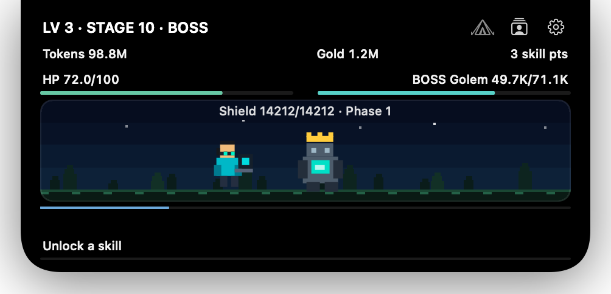
  <br>
  <em>Expanded, hovering the notch.</em>&ensp;&ensp;
  
  <br>
  <em>Collapsed, the resting pill.</em>
</p>

<p align="center">
  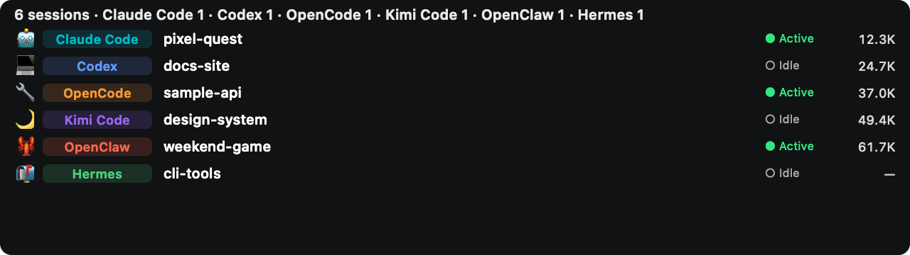
  <br>
  <em>The list shared by the HUD and <strong>Settings → Sessions</strong>.<br>Illustrative fixture data, with one row per agent/project and unknown usage kept distinct from zero.</em>
</p>

### The journey: stages, batches, bosses

- Monsters stand at fixed spots in the world. The ground scrolls at 54 pt/s under a
  three-layer parallax backdrop, carrying the next monster in from the right; the world
  pauses when it reaches melee range and resumes when it falls.
- Monsters arrive in **batches of 5–8** (boss encounters: a single boss), spaced 120–180 world
  units apart. Killing one advances to the next in the batch after 0.85 s.
- Every **8 kills** advances the stage. **Every 5th stage is a boss stage**: crowned, larger,
  ×2.2 HP, double XP, a guaranteed Rare-or-better equipment drop, and 20–40 bonus gold.
  Boss kinds cycle independently across boss encounters, so the stage cadence cannot
  repeatedly select the same monster.
- Monster HP scales as `base × 100 × (1 + 0.10 × (stage − 1)) × (boss ? 2.2 : 1)`, so a
  Stage-1 Prompt Wraith shows ~12K and its Stage-5 boss encounter ~37K.

### Enemy mechanics and camp

- **Cache Golem** starts with a one-time shield worth 20% of its maximum HP. Basic attacks
  and active skills both consume shield before HP. The HUD shows shield remaining, and
  damage beyond shield plus HP carries forward to the next enemy.
- **Token Slime** recovers 0.1% of maximum HP per second while engaged and idle. New token
  activity stops recovery for the normal 15-second activity window. It cannot heal while
  defeated, travelling or at camp. Sustained usage and stronger builds overcome it.
- **Boss phase 2** begins at 50% HP and increases incoming attack damage by 50%. The phase
  stays active for that encounter, even if a Slime heals above half health. The persistent
  mechanics line shows the phase; its tooltip explains the rule.
- **Rest at camp** uses the tent button in the expanded header, including in Sessions mode.
  Camp pauses both sides' attacks, travel, enemy recovery and Auto Cast. Usage keeps counting;
  token damage waits in the combat ledger and learned skills keep charging to the 40,000
  cap. Token healing continues, alongside 0.5 HP per second of camp recovery. A defeated
  hero revives at 28% HP and stays at camp until **Leave camp** is selected. Leaving rest
  resets the enemy attack clock and resumes pending damage in bounded batches.

The camp preference survives relaunches. Current HP, skill energy and pending combat damage
are session state; quitting the app resets them. Lifetime XP, kills, inventory, learned
skills and recorded agent usage remain available.

<p align="center">
  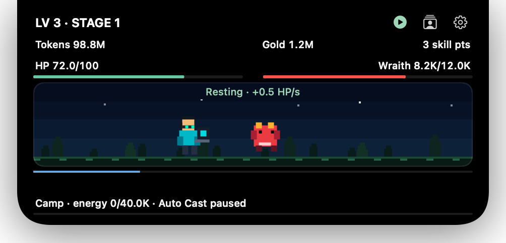
</p>

### Combat feel

- **Sword arcs and lunges.** Each hero strike sweeps a glowing arc through the monster while
  the hero lunges and tilts into it; the monster answers with a claw rake that lands *on*
  the hero.
- **Damage beside the victim.** Lost HP pops out next to whoever got hit — on the monster's
  outer side, mirrored to the hero's left — so it always reads as "that actor lost that much".
- **Token segments.** Damage uses fixed 250-token segments. Partial segments apply their
  earned damage immediately and retain their multiplier and crit result for later tokens.
  The ledger stores a large batch in compressed integer form and resolves at most 512
  segments per logical tick; the rest carries forward across enemies and HUD states.
- **Combo** ×10 max: each new segment adds one point, each point adding +5% damage.
  A gap over 12 seconds or an enemy hit resets the next segment's combo. Already earned
  damage and the current partial segment keep their original values.
  **Crits** have a 12% chance of double damage per segment, using a random run seed and
  stable segment number. Splitting a log update cannot reroll them.
- **Bounded animation.** At most 12 visual strikes wait in the animation queue. Clearing
  effects, collapsing the HUD or opening Sessions never removes earned damage. Tiny
  hits keep a visible bar sliver without increasing the actual damage.
- **Auto Cast.** Every 2-second logical tick may cast one enabled skill. The highest-tier
  skill whose cooldown has finished reserves energy until its full cost is available;
  while it cools down, lower-tier ready skills can cast. Costs and cooldowns commit only
  against a living, engaged enemy. Cast damage enters the same persistent combat budget
  immediately, including overkill carried to the next monster.
- HP bars keep a ghost trail behind the real bar, and pulse below 30% hero HP. Monsters flash,
  shake, and spray sparks; level-ups fire a golden burst; bosses arrive heavy.
- Scene effects are bounded and pooled, and render only in the visible expanded battle.
  The collapsed pill uses brief hero/bar feedback; camp and Reduce motion disable it.

<p align="center">
  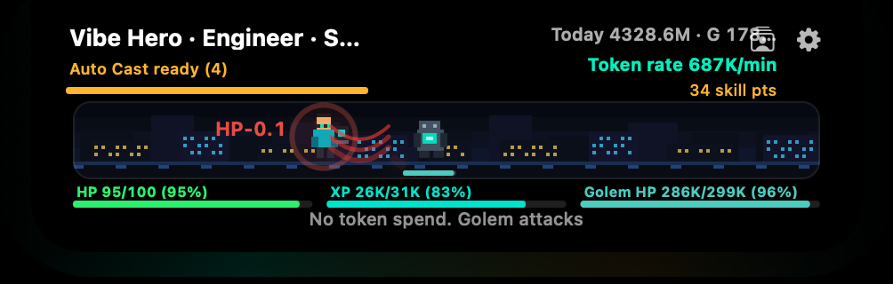
  <br>
  <em>Earlier combat-effects example: the claw rake and damage number land beside the hero.</em>
</p>

### Roles, monsters, loot, levels

Six roles (PM / Designer / Artist / Engineer / QA / Other) trade token-strike damage against
idle defense — Engineer hits hardest (+15%), QA takes the least idle damage (−25%). Four
monsters rotate (Prompt Wraith, Cache Golem, Token Slime, Null Sentinel). Kills roll potions,
Power Boosts, gold, and rarity-tiered Weapon/Armor/Charm drops that auto-equip or salvage into
gold. Hero level comes from kill XP only — never directly from tokens.

**Settings → Equipment** shows gold, the remaining Power Boost time, each slot's current
bonus, and its next upgrade. Upgrading is guaranteed: Common → Uncommon costs 30 gold,
Uncommon → Rare 60, Rare → Epic 120, and Epic → Legendary 240. Empty slots need a drop
first, and Legendary is the cap. A failed purchase never spends gold. Higher-quality drops
automatically replace that slot; equal or lower-quality drops become gold, including the
build's gold bonus once.

The latest 40 rewards show their actual outcomes: HP restored (including fractional or
zero healing at full HP), Power Boost seconds added, gold credited, equipment equipped or
salvaged, and upgrades purchased. Boss bonus gold is a separate entry. History follows the
selected language and persists even while the battle is collapsed or Sessions is visible.
Gold, gear, buff expiry, and history are saved together in one inventory record; existing
saves migrate once without replaying old rewards.

<p align="center">
  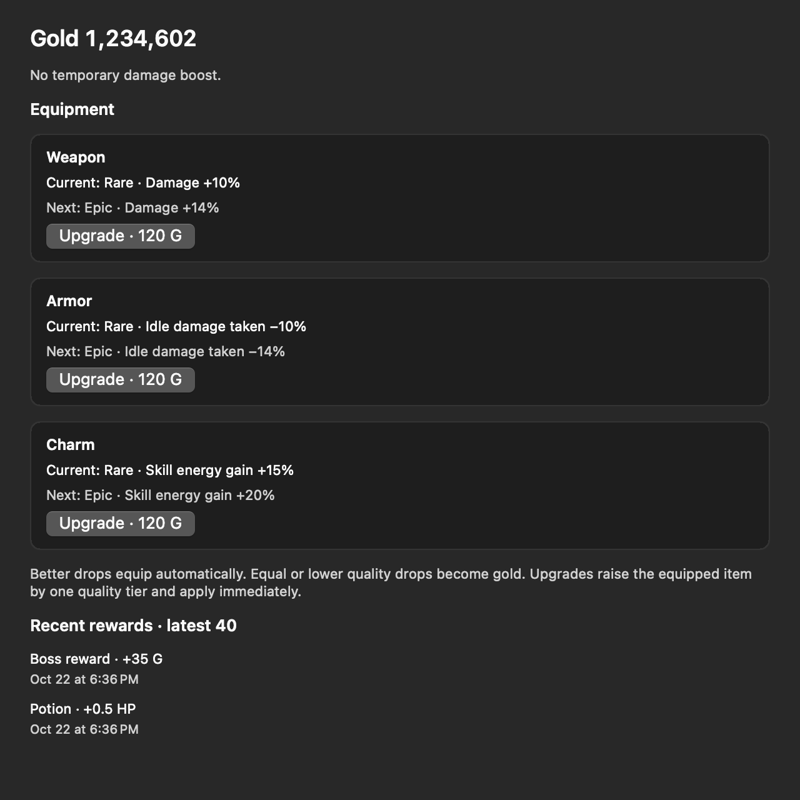
</p>

The exact numbers live in code, one table per kind of content: role perks in
`Game/Content/RoleCatalog.swift`, monster HP/XP in `Game/Content/MonsterCatalog.swift`, loot and
rarity odds in `Game/Systems/ItemSystem.swift`, and the level curve in
`Game/Rules/HeroExperience.swift`.

### Backdrops

Pick one in **Settings → General → Scene**: Midnight Forest, Crystal Cave, Sunset Dunes, or
Neon City. Each draws a starfield/skyline/dune sky plus three endlessly scrolling parallax
layers (far silhouettes, near silhouettes, ground marks).

### Settings

Five tabs, all persisted in `UserDefaults` under `VibeHero.*` keys:

| Tab | Contents |
|-----|----------|
| **General** | Language, display pinning, hide-in-full-screen, battle backdrop |
| **Game** | Hero role; passive skill tree; active skills and Auto Cast preferences |
| **Equipment** | Gold, Power Boost timer, Weapon / Armor / Charm bonuses and upgrades, recent rewards |
| **Tools** | Agent hook setup and Kimi Code automatic-reader status |
| **Sessions** | The same live agent-session list as the HUD |

`Hide in full screen` (off by default) hides the notch while an app covers the whole pinned
screen; push the pointer against the top edge to peek it back out, like the menu bar.

<p align="center">
  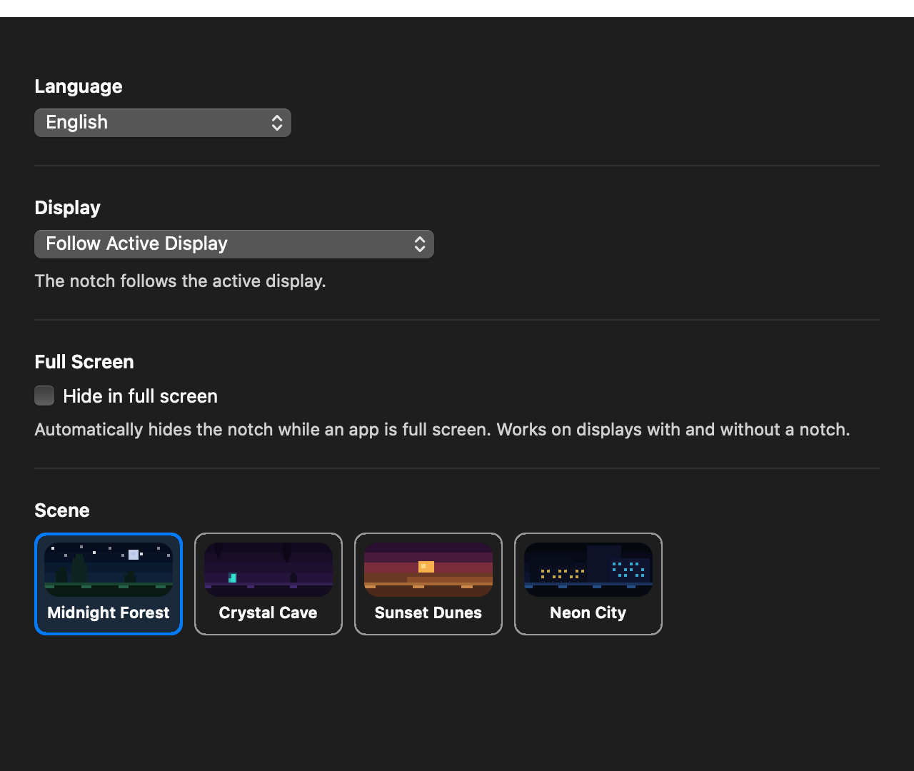
  <br>
  <em><strong>General</strong> — language, which display to pin to, hide-in-full-screen,<br>and the Scene picker with a live thumbnail of each backdrop.</em>
</p>

<p align="center">
  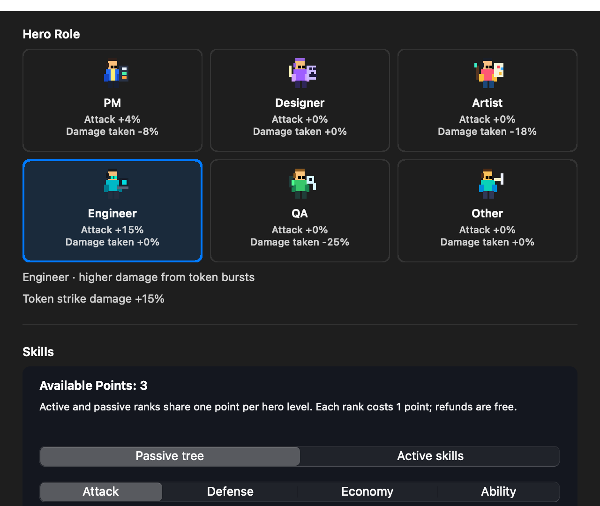
  <br>
  <em><strong>Game</strong> — the six hero roles, each with its own pixel portrait and perk.<br>Passive and active skills share one point budget below the role selection.</em>
</p>

### Token sources & privacy

Nothing leaves your machine. The usage scanner retains timestamps, token counters and
session/project identities; it does not retain prompts or completions. The readers live in
`Sources/VibeHero/Integrations/TokenUsage.swift` and `KimiWireUsage.swift`, and
`Integrations/AgentSourceCatalog.swift` declares their roots.

| Source | Path |
|--------|------|
| Claude Code | `~/.claude/projects/**/*.jsonl` |
| Codex | `~/.codex/sessions/YYYY/MM/DD/*.jsonl` |
| Codex (archived) | `~/.codex/archived_sessions/**/*.jsonl` |
| Kimi Code | `~/.kimi-code/sessions/*/*/agents/*/wire.jsonl` |
| Kimi CLI (legacy) | `~/.kimi/sessions/*/*/wire.jsonl` and `subagents/*/wire.jsonl` inside each session |
| Hook fallback | `~/.vibe-hero/token-events.jsonl` |

Local logs can lag a few seconds. **Settings → Tools** installs faster event hooks that write
to the fallback log:

| Agent | Install target |
|-------|----------------|
| Claude Code | hooks appended to `~/.claude/settings.json` |
| Codex | hooks appended to `~/.codex/hooks.json`, `codex_hooks` enabled |
| OpenCode | plugin under `~/.config/opencode/plugins` |
| Kimi Code | Automatic native log reading; no installation or config changes |
| OpenClaw | Helper script at `~/.openclaw/hooks/vibe-hero-token.sh` |
| Hermes | Helper script at `~/.hermes/hooks/vibe-hero-token.sh` |

OpenClaw and Hermes use the shared hook-event format. Their existing setup buttons create
helper scripts; end-to-end delivery from those agents has not been validated by this audit.

JSONL logs stay the primary source where they exist. The scanner counts Codex cumulative
counters as deltas, merges repeated Claude generation updates, and keeps session identity
when logs move into the archive. It also discovers sessions created on earlier days when
they receive new writes today. Cache and reasoning subtotals are not added twice.

Hooks with a session ID fill gaps for that session; primary logs take precedence. When an
older hook supplies no session identity, its source's primary logs take precedence to avoid
double-counting. Hooks should include a stable event ID: without one, identical timestamps
and counters cannot distinguish two equal-sized calls. OpenCode currently uses the hook fallback.

Kimi Code reads the official flat `usage.record` events (millisecond timestamps), including
turn and session usage; legacy Kimi CLI reads direct `StatusUpdate.token_usage` events
(second timestamps). Cache-read and cache-creation counts are disjoint from ordinary input.
Each agent's own wire log is read once; replay objects and parent `SubagentEvent` copies are
ignored. Current forks count only records after the last `forked` marker. Legacy forks have
no origin marker, so repeated provider message IDs count once across sessions and shared
history stays unattributed. Records without IDs use timestamp/counter fingerprints; identical
simultaneous calls cannot be distinguished (current wire fingerprints also include agent/model).

The app honors `KIMI_CODE_HOME` and legacy `KIMI_SHARE_DIR` when present in its launch environment.
See the official [Kimi data locations](https://github.com/MoonshotAI/kimi-code/blob/main/docs/en/configuration/data-locations.md),
[usage accounting](https://github.com/MoonshotAI/kimi-code/blob/main/packages/agent-core-v2/src/session/usage/usageAgentModel.ts),
and [legacy usage emission](https://github.com/MoonshotAI/kimi-cli/blob/main/src/kimi_cli/soul/kimisoul.py).
**Tools → Kimi Code → Auto-read** shows **Waiting for usage** until today's native usage has
actually been parsed; the presence of a directory or an old MCP config does not establish readiness.

<p align="center">
  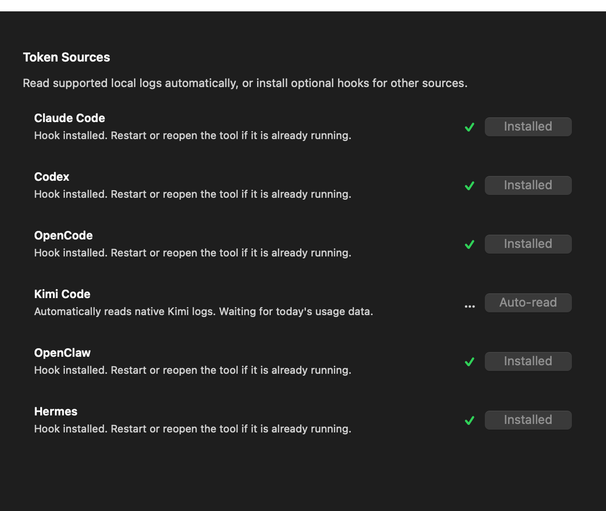
  <br>
  <em><strong>Tools</strong> — automatic native sources and optional hook installers.<br>Restart a tool after installing its hook. Kimi needs no installation.</em>
</p>

### Removing the token hooks

Everything the installer adds sits next to the config it modifies and is marked with
`vibe-hero`. To uninstall by hand:

| Agent | Remove this |
|-------|-------------|
| Claude Code | the `PostToolUse` / `Stop` / `SessionEnd` hook entries containing `vibe-hero-token-hook` in `~/.claude/settings.json` |
| Codex | the hook entries containing `vibe-hero-token-hook` in `~/.codex/hooks.json`; optionally drop `codex_hooks = true` from `~/.codex/config.toml` |
| OpenCode | `~/.config/opencode/plugins/vibe-hero-token.js`, plus its path in the `plugin` array of `~/.config/opencode/config.json` |
| Kimi Code (old Vibe Hero installs only) | Remove `~/.vibe-hero/mcp/kimi-token-server.js` and only the `[mcp.servers.kimi-token-server]` block that points to that file in `~/.kimi-code/config.toml`; preserve other MCP entries. The app does not modify this legacy configuration automatically. |
| OpenClaw | `~/.openclaw/hooks/vibe-hero-token.sh` |
| Hermes | `~/.hermes/hooks/vibe-hero-token.sh` |

Once no agent references it any more, the shared script and its event log can go too:
`~/.vibe-hero/hooks/vibe-hero-token-hook` and `~/.vibe-hero/token-events.jsonl`. The app
keeps working without hooks — Claude Code, Codex and Kimi still have their native logs;
OpenCode's hook fallback stops receiving events.

### Localization

English, 简体中文, 日本語 — switched in **Settings → General → Language**. English is the
fallback.

---

## 2. Development guide

### Requirements

macOS 14.0+, a Swift 6 toolchain (full Xcode by default), and nothing else — no CocoaPods, no
SPM dependencies, no code generation.

### Commands

```sh
make run      # swift run VibeHero
make dev      # run + auto-restart on any change under Package.swift / Sources
make build    # debug build   → .build/arm64-apple-macosx/debug/VibeHero
make test     # build and run XCTest with the selected Xcode toolchain
make test-local # explicit local compiler/XCTest paths when CLT lacks XCTest
make release  # release build → .build/release/VibeHero
make app      # app bundle    → ".build/app/Vibe Hero.app"
make install  # copy the bundle to /Applications
make clean    # swift package clean
```

`make dev` (`scripts/dev-run.sh`) polls source mtimes every second and restarts the process on
change — an auto-restart loop, not Swift hot reload. To point Swift at another toolchain:

```sh
make run DEVELOPER_DIR=/path/to/Xcode.app/Contents/Developer
```

`make test-local` compiles into a temporary directory using Command Line Tools and the
XCTest frameworks already present in Xcode. It does not change `xcode-select` or system
configuration. Use `python3 scripts/test-local.py --help` for explicit toolchain paths, or
`make test-local TEST_LOCAL_ARGS='--suite TokenUsage'` to select test classes. CI runs the
standard `swift build` and `swift test` commands.

Cutting a release is one command — it bumps the version, tags, pushes, updates the Homebrew
tap formula, and creates the GitHub Release with the zipped bundle:

```sh
scripts/release.sh 0.1.2 [notes.md]
```

The app is `LSUIElement`, so it never appears in the Dock. Use the menu bar icon to re-show
the notch or quit. `pkill -f 'Vibe Hero'` kills a bundled instance; `pkill -f VibeHero` kills
a `swift run` one.

### Source layout

Five layers under `Sources/VibeHero/`. Content and rules are deliberately free of AppKit view
code, so they are unit-testable and so adding content does not mean editing views.

| Path | Responsibility |
|------|----------------|
| `main.swift` | AppKit entry point |
| `App/AppDelegate.swift` | Accessory lifecycle, menu bar item, screen/language observers |
| `App/LegacyDefaultsMigration.swift` | One-time `NotchHero.*` → `VibeHero.*` key rename |
| `App/NotchWindow.swift` | Transparent borderless always-on-top panel anchored to the notch |
| `App/FullScreenMonitor.swift` | Detects apps covering the pinned screen; drives hide-in-full-screen |
| `App/ScreenPinning.swift` | Which display the overlay lives on |
| `Core/Localization.swift` | All UI strings in English, Simplified Chinese and Japanese |
| `Core/Defaults.swift` | Every persisted `UserDefaults` key, in one place |
| `Game/Content/MonsterCatalog.swift` | Monster stats, colors, shards, sprites — one entry per monster |
| `Game/Content/BackdropCatalog.swift` | Backdrop sky + parallax painters — one entry per backdrop |
| `Game/Content/RoleCatalog.swift` | Role labels, perks, palettes, accessory sprites |
| `Game/Content/PixelSprite.swift` | The 16×16 grid-unit sprite primitive and its renderer |
| `Game/Rules/CombatTiming.swift` | Attack cadence, tiers, crit odds, damage multipliers |
| `Game/Rules/TokenCombatAccounting.swift` | Fixed token segments, stable crit/combo, bounded budget resolution |
| `Game/Rules/CombatDamageBank.swift` | Absolute earned damage, with overflow preserved across enemies |
| `Game/Rules/MonsterMechanicsState.swift` | Shield absorption, idle recovery and persistent boss phase per encounter |
| `Game/Rules/CampProgress.swift` | Persisted rest preference |
| `Game/Rules/StageProgress.swift` | Stages, boss cadence, HP/XP scaling, encounter planner |
| `Game/Rules/HeroExperience.swift` | The level curve and persisted lifetime XP |
| `Game/Systems/SkillSystem.swift` | Active skill catalog, loadout and Auto Cast preferences |
| `Game/Systems/SkillTreeSystem.swift` | Unified passive/active ranks, migration, point budget and combat modifiers |
| `Game/Systems/ItemSystem.swift` | Atomic inventory save, equipment upgrades, loot, gold, Power Boost and reward history |
| `Views/Notch/NotchContentView.swift` | Collapsed + expanded HUD: construction, layout, hover, styles |
| `Views/Notch/NotchContentView+Combat.swift` | Token polling → attacks, damage, XP, loot, defeat/revive |
| `Views/Notch/NotchContentView+EncounterPresentation.swift` | Camp controls and persistent enemy-mechanic feedback |
| `Views/Notch/NotchStyle.swift` | Notch geometry and silhouette |
| `Views/Notch/NotchScreenGeometry.swift` | Screen safe area, real cutout anchoring and bounded window placement |
| `Views/Notch/HUDPresentationPolicy.swift` | Visible/collapsed/session modes and Reduce motion policy |
| `Views/Battle/BattleSceneView.swift` | World simulation, monster queue, engagement, game loop |
| `Views/Battle/BattleSceneView+Effects.swift` | Loot, revive, floating text, combo/banner/level-up |
| `Views/Battle/BattleSceneView+AttackEffects.swift` | Hero energy laser and monster wolf claw |
| `Views/Battle/EffectLayerPool.swift` | Reused `CAShapeLayer`s for replayed effects |
| `Views/Battle/PixelActorView.swift` | Draws a hero or monster sprite; walk/attack/activity animations |
| `Views/Battle/BackdropView.swift` | Paints a `BackdropSpec` and drives the parallax scroll |
| `Views/Battle/PixelBarView.swift` | HP/XP/energy bars |
| `Views/Sessions/SessionListView.swift` | The expanded-panel session list and its rows |
| `Views/Settings/NotchSettingsWindow.swift` | Settings window shell and tab switching |
| `Views/Settings/Tabs/*.swift` | One file per tab: General, Game, Equipment, Tools, Sessions |
| `Views/Settings/SettingsChoiceViews.swift` | Role and backdrop picker cells |
| `Views/Settings/SkillTreeView.swift` | Skill-tree canvas and current/next-effect detail panel |
| `Integrations/AgentSourceCatalog.swift` | Where each agent writes its logs — one entry per agent |
| `Integrations/TokenUsage.swift` | Incrementally tails local JSONL logs into a token snapshot |
| `Integrations/TokenHookInstaller.swift` | Agent hook configuration/helper scripts; Kimi automatic-reader status |
| `Integrations/SessionMonitor.swift` | Live agent processes joined with the shared verified usage snapshot |

### Conventions

- **All user-facing text goes through `Localization.swift`**, with entries added for all three
  languages. English is the fallback. This is a hard project rule (see `AGENTS.md`) and it
  covers menu items, settings labels, HUD status text, combat text, monster and role names,
  and empty/error states.
- Swift 6 strict concurrency: UI types are `@MainActor`; anything crossing a thread boundary
  is `Sendable`. Background scans hop to a utility queue and come back to `main`.
- 4-space indent, K&R braces, `private` by default, no force-unwraps in view code.
  There is **no** SwiftLint/SwiftFormat config — don't run `swift-format` with its defaults,
  it will reformat the tree to 2-space indent.
- Persisted state uses `UserDefaults` keys prefixed `VibeHero.`. Gear, gold, buff expiry and
  rewards share `inventory.state.v1`; passive/active skill ranks share `skillTree.build.v1`.
  Other keys include `totalKills`, `heroTotalXP`, `backdrop`, `language`, `pinnedDisplayID`
  `hideInFullScreen` and `isCamping`. They are declared in `Core/Defaults.swift`; use `DefaultsKey`.
  Legacy equipment, gold and skill keys are migration backups. Deleting only those old
  keys does not reset the current save.
- Comments explain *why*, especially where a fix encodes a platform quirk. Several of the
  comments under `Views/Battle/` are the only record of the bugs below.

### Rendering & animation notes

The battle scene is hand-drawn CoreGraphics plus pooled CALayers, and it has bitten us in five
specific ways. All of these are load-bearing:

1. **Never `view.layer?.addSublayer(...)` for effects.** AppKit keeps subview backing layers at
   the *end* of a layer-backed view's `sublayers`, so a raw sublayer renders *below* every
   subview — that is how the entire effect suite once became invisible behind the backdrop. Add
   effects to the `EffectOverlayView` host (`effectsLayer`), which is added last.
2. **Suppress implicit animations when repositioning pooled layers.** A bare `CALayer` animates
   its own `position`/`bounds` over ~0.25 s, so a reused hit layer glides in from the previous
   hit while its explicit animation plays elsewhere. Use `placeEffect(_:at:)` /
   `placeEffect(_:frame:)`, which wrap the move in `CATransaction.setDisableActions(true)`.
3. **Build effect paths around `.zero` and move the layer.** A path in scene coordinates on a
   zero-bounds layer scales away from the *scene origin* under `transform.scale`, landing the
   art 60–130 pt off target.
4. **Pause/resume with `timeOffset` and `beginTime`, never `speed` alone.** `speed = 0` drops
   local time to `timeOffset` (0) and snaps an animation back to its start; `speed = 1` then
   jumps to the "as if never paused" phase. For the parallax scroll that was a jump of up to a
   full period (>200 pt) on every kill, which read as the hero teleporting sideways. See
   `BackdropView.pauseScroll(_:)` / `resumeScroll(_:)`.
5. **Let effects self-clean.** Give the layer a model state that is invisible (`opacity = 0`)
   and animate opacity `[1, 1, 0]`; no `asyncAfter` cleanup, no leaked layers.

Performance rules of thumb: pool layers instead of allocating per hit, animate layer transforms
instead of redrawing sprites or resizing `NSTextField`s (that re-renders text every frame), and
gate animations on `animatesCombatEffects`, which requires a visible expanded battle and
Reduce motion to be off. Static feedback may still appear when motion is reduced.

### Verifying visual changes

Use isolated fixtures for repeatable layout checks:

```sh
python3 scripts/render-preview.py /tmp/vibe-hero-preview
```

The script renders all three languages with sample saves, including camp, defeat, enemy
mechanics and light/dark settings. Tools previews read installation status but never install
hooks. Session rows are synthetic. It leaves the player's preferences and agent logs unchanged.

- Log real animation math instead of eyeballing it: read
  `layer.presentation()?.value(forKeyPath: "transform.translation.x")` at known times and
  compare against the expected rate. This is how the scroll pause/resume fix was proven.
- Use `Defaults.withStore` with a temporary suite and `startMonitors: false`, so fixtures
  cannot read agent logs or change the player's save. Attach each view to a hidden window,
  lay it out, remove animations, and use `cacheDisplay(in:to:)` for a 2× PNG. No visible
  desktop window or screen capture is needed for layout verification.
- Check all three languages, light/dark settings, long totals, no usage, defeat and camp.
  Clear the temporary suite afterward. Offscreen rendering does not verify real animation
  timing, physical camera cutouts, Spaces or full-screen occlusion; those need separate checks.

### Where to add things

Each row is one enum case plus one catalog entry. No view code changes for new content —
`ContentCatalogTests` fails if an enum case has no catalog entry.

| Change | Touch |
|--------|-------|
| New monster | a `MonsterKind` case + a `MonsterSpec` in `Game/Content/MonsterCatalog.swift` (stats, colors, and a `PixelCell` sprite) + name keys in `Localization.swift` |
| New backdrop | a `BattleBackdrop` case + a `BackdropSpec` in `Game/Content/BackdropCatalog.swift` (a sky painter and three `ScrollSpec` layers, written against `BackdropCanvas`) + a name key |
| New role | a `HeroRole` case + a `RoleSpec` in `Game/Content/RoleCatalog.swift` (palette + accessory sprite) + strings |
| New skill | a `HeroSkill` case + a `SkillSpec` in `Game/Systems/SkillSystem.swift`; ranks, the loadout, and the damage multiplier all derive from `allCases` |
| New token source | an `AgentSource` in `Integrations/AgentSourceCatalog.swift` (reuse a `Layout` and no reader is needed); add an installer case in `TokenHookInstaller.swift` and an `IDEType` in `SessionMonitor.swift` only if it needs a hook or a session row |
| New HUD element | add it to `gameHUD` in `NotchContentView.setupExpandedHUD` and give it a frame in `layoutExpandedHUD`; the container handles hiding it in session mode |
| New setting | the matching tab in `Views/Settings/Tabs/`, a key in `Core/Defaults.swift`, and strings |

---

## 3. Status & roadmap

### What is playable today

Token-driven combat, the walking world, stages and bosses, combo/crit, XP and levels, loot,
gold, auto-equipping gear, upgrades and reward history, passive and active skills, four
backdrops, roles, the live session list, native usage readers and optional hooks,
hide-in-full-screen, Reduce motion, shield/regeneration mechanics, phased bosses, camp,
and three languages.

Passive and active skills share the points earned from hero levels. Refunds are free;
a prerequisite cannot be refunded below the level required by a learned descendant.
Legacy saves migrate once, preserving learned ranks. Any migration credit is part of
the same saved budget and cannot be regenerated by refunding or reloading.

<p align="center">
  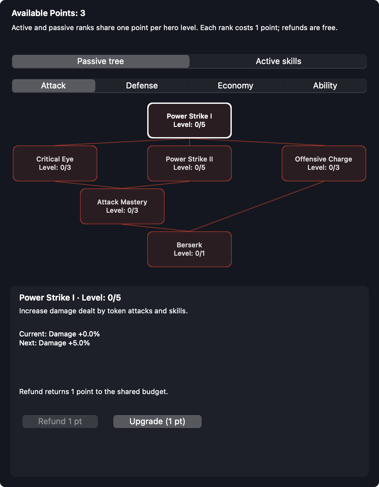
  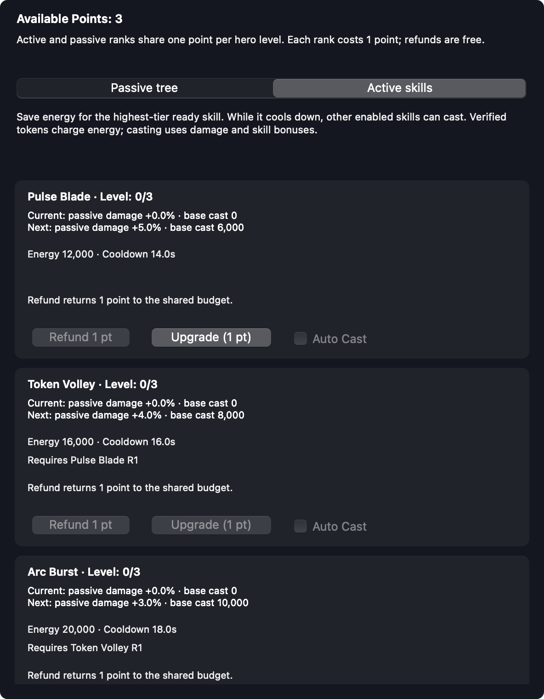
</p>

Passive nodes affect damage, crit chance, maximum HP, damage reduction, regeneration,
gold, empty-drop rescue, XP, skill damage, cooldowns and energy charging. Maximum HP
increases the actual health pool; enemy damage, potions and token healing remain absolute
HP amounts. Regeneration restores 0.01/0.02/0.03 HP per second and cannot revive a defeated
hero. The two charge bonuses multiply energy earned from tokens, without changing scan
frequency or basic attack damage.

Active skills deal `energy cost × (0.5 + 0.25 × (rank − 1))` base damage, multiplied by
the build's damage and skill-damage bonuses, role, weapon and Power Boost. They do not
roll another crit or gain combo damage. Cooldowns use elapsed time, reduced by ability
nodes. Gold bonuses apply once to ordinary gold, boss gold and salvaged equipment.
Empty-drop rescue applies only to the normal table's 16% empty outcomes and, when it
succeeds, guarantees one real reward.

### Known gaps

- **Equipment uses three automatic slots.** Upgrades and reward history are available; there is
  no backpack or manual equip/unequip.
- **Combat state lasts for one app session.** Pending damage, current health and skill energy
  are not restored after quitting. Camp mode itself, earned progression and inventory persist.
- **Hardware checks remain separate.** Geometry tests cover camera cutouts, off-center
  gaps, external displays and multi-screen coordinates. Physical cutout appearance and
  macOS Spaces/full-screen event timing still need validation on the relevant hardware.
- **Unsigned.** The app bundle includes its icon, but signing and notarization remain open.

### Roadmap

**Next**

- Explore an optional backpack and manual equipment choices if the three automatic slots
  no longer provide enough build decisions.

**Then**

- A native log reader for OpenCode, so it stops depending on hooks.
- Per-agent attribution in combat: which agent's tokens landed the hit, using the data the
  session list already collects.
- Session list interaction — click a row to focus that project or agent window.
- Signing and notarization for downloadable releases.
- More scenes and enemy mechanics, persistent combat-state recovery, and a run summary
  (daily tokens → damage → levels).

**Maybe**

- A menu bar mini mode for displays without a notch.
- Optional sound, off by default.
- Import/export of a save.

---

Project rules for contributors: [`AGENTS.md`](AGENTS.md)
